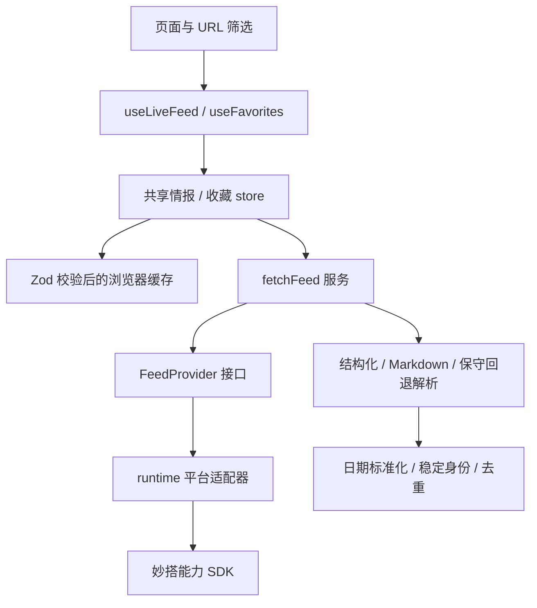

# 架构与运行流程

## 前后对比

| 修改前                                                        | 修改后                                                  |
| ------------------------------------------------------------- | ------------------------------------------------------- |
| 每个页面运行约 900 行 useLiveFeed，混合检索、提取、解析、存储 | 薄 Hook，共享 store，独立 service/provider/parser/cache |
| SDK、页面和浏览器存储直接耦合                                 | runtime 接口边界；平台与静态运行时分别构建              |
| 顺序下标 ID，日期猜测，缓存强制类型转换                       | 内容身份 ID，保留日期精度，Zod 边界验证，已知旧缓存迁移 |
| 单页面收藏 state                                              | 共享外部 store，跨组件和跨标签存储事件同步              |
| 构建脚本引用缺失文件，无测试                                  | 可复现锁文件、两种构建、测试及 CI 门禁                  |

## 模块职责

- `src/features/feed/types.ts`：可信输出类型与输入 schema。
- `provider.ts`：SDK 插件契约、每次搜索 45 秒、提取 30 秒、字符串及流分片上限。
- `service.ts`：15 个检索任务，最多 3 个并发；仅限流重试 2 次，指数退避加随机抖动；投资文本按 200k 字符批次提取，避免重复付费调用。
- `parsers.ts / dates.ts / identity.ts`：纯业务转换。融资身份包含公司、机构、轮次、日期；展会身份包含名称、开始日期。编码后适合 URL，同公司不同轮次分别保留。
- `cache.ts`：v3 → v4 校验与已知下标映射；拒绝坏结构、未来时间、超大数据。只有可验证映射才迁移收藏，未找到映射的旧收藏不绑定到新事件。
- `store.ts`：共享订阅，180 秒整体期限，取消及 generation 检查；旧请求不能覆盖新请求，刷新失败保留旧数据；某类未提取到条目时保留旧类并提示。
- `favorites/store.ts`：共享收藏和存储事件；存储失败保留会话数据及提示；确认身份后持久化迁移。
- `infrastructure/runtime.ts`：保留平台容器、SDK 和 scopedStorage；独立构建精准 alias 到 native 浏览器运行时，无平台 JS 认证或 telemetry。

## 初学者运行说明

打开页面时 Hook 订阅 store。新鲜缓存直接展示；无缓存或过期缓存触发一次共享检索。检索结果经提取与校验，生成可展示条目并保存浏览器缓存。列表从共享数据按 URL 筛选，详情按身份在同一份数据里找记录。收藏也来自共享 store，因此在列表收藏后，详情能立刻看到。

## 关键取舍

不增加后台、微服务、任务队列、认证和容器集群：当前产品是依赖平台能力的浏览器工具，没有真实多租户或服务端持久化需求。依赖注入仅在 loader/provider/storage 边界，便于测试。

SDK 不提供传输 AbortSignal：本地停止等待并尽力关闭迭代器，不能保证已发出的远程请求停止或不计费。身份依赖内容，机构/轮次/日期被纠正后可能改变 ID；没有上游永久事件 ID 就无法保证永久链接。详情仅对应当前缓存，无跨浏览器的事件数据库。

旧数据保留最多 30 天并显示更新时间/更新失败；保留的分类可能比整体更新时间更旧，提示明确表示部分未更新。需要逐条来源、长期归档和可靠订阅时，再设计有持久存储的后端。
