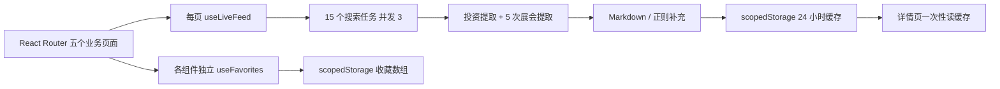

# 仓库审计与整改路线图

审计日期：2026-10-11。基线：`4376eab01cdd7c705ec74bb9f0c532ccff00293c`（main）。
依据：112 个 tracked 文件的目录/配置检查、全部业务页面和数据引擎阅读、UI 模板风险扫描、实际安装/静态检查/依赖审计。未在真实妙搭租户调用付费插件、未接触生产数据。通用 UI 模板未逐一做交互验收。

## 产品与当前执行流程

面向投资研究员、创业者和科技从业者的中文情报浏览器，保留首页、投资目录/时间线、展会列表、详情、收藏与 AI 搜索定位。

技术栈：React 19、TypeScript 5.9、Vite 8、Tailwind 4、Radix/shadcn、React Router 7、framer-motion。构建、ESLint、TypeScript 继承妙搭 preset。数据由 `shared/capabilities/*.json` 配置的妙搭搜索/结构化提取插件获取；无独立 HTTP API、数据库、账号系统、服务端任务或迁移。`src/data` 只有类型，没有 mock 数据。README 的本地 mock 说明与实际代码不符。

## 已有优势

- 页面与 sections 已分层，列表筛选、目录与时间线、参展商分页具备可保留价值。
- 使用类型、React 默认文本转义、react-markdown 默认安全 URL 转换；未发现业务 HTML 注入。
- 插件声明集中，已有限流重试、并发上限、版本化缓存和错误边界。
- 锁文件、ESLint 和类型检查已存在，外链设置了 noopener/noreferrer。

## 基线验证

| 检查 | 实际结果 |
| --- | --- |
| 原始 `npm ci --ignore-scripts` | 失败：锁文件遗漏 oxide/lightningcss/rolldown 跨平台 optional 依赖 |
| 修复锁文件后 `npm run lint` | 通过，包含原有 app 类型检查 |
| `npx tsc -p tsconfig.node.json` | 通过 |
| 原始 `npm run build` | 失败：调用 bash，且 `scripts/build.sh` 根本不存在 |
| 原始 `npm test` | 失败：未定义 test 脚本，也没有测试文件 |
| `npm audit --json` | 37 项：4 critical、21 high、12 moderate（含传递依赖与开发依赖，并非 37 个可利用业务漏洞） |
| GitHub workflow/issue 查询 | 仅平台 pages-build-deployment；未发现源码 CI workflow；issue 列表为空 |

执行环境：Windows，Node 26.3.0 / npm 11.16.0。检查的依赖告警保存在 `docs/security/audit-baseline.json`。安装脚本先禁用，再明确审查必要脚本。

## 分级风险与路线图

| 优先级 | 核实位置 / 问题 | 验收标准 |
| --- | --- | --- |
| P0 | package.json：缺失构建入口、锁文件无法 clean install | 跨平台 npm ci/build 可执行，构建生成可预览文件 |
| P0 | scripts/dev.mjs：execSync 拼接未校验端口且 killOrphansByPort 杀任意占用者；Windows npx spawn 不兼容 | 开发启动不执行 shell 拼接、不杀非本项目进程、端口冲突明确报错 |
| P0 | useLiveFeed：callStream 输入 `{query,instruction}`，声明只接收 additional_keywords | 适配器契约测试与 JSON paramsSchema 一致 |
| P0 | useLiveFeed：所有子搜索失败返回空串，却标记 done 并缓存“成功” | 全失败产生错误，不覆盖原有好数据；部分成功提示不完整 |
| P0 | 下标 ID、按公司去重、正则公司取 m[2] 得到“完成”、日期乱补 1 月 1 日、展会结束日期丢失 | 顺序改变不串收藏；同公司不同轮次保留；日期合法、不虚构精度；范围保留 |
| P0 | 缓存 JSON 强制断言、返回未来 timestamp / 非数组、不受限 AI 输入 | 运行时 schema 校验、时间/大小/数量边界与坏数据回归测试 |
| P0 | 共享 abortRef 被 refresh 重置；无请求超时；StrictMode 与多个消费者重复请求 | 每次请求独立取消、最新请求生效、超时退出、单一共享状态 |
| P0 | 依赖安全风险 | 先兼容修补，扫描保留余项，不以 audit --force 掩盖兼容性问题 |
| P1 | useFavorites：各实例独立 state、初始 effect 可能覆盖别处更新、无元素校验 | 同页多实例立即同步，坏存储降级，写失败可见 |
| P1 | 详情只读持久化缓存，存储失败/TTL 到期导致当前列表链接失效 | 所有页面读取共享内存状态；已有缓存可展示，刷新失败保留 |
| P1 | 投资 URL 仅初次读，展会未同步；详情返回丢筛选；unknown date 显示 NaN | URL 单一状态源、后退可恢复；未知日期诚实显示；可访问导航 |
| P1 | 无测试、CI、格式化门禁、可靠部署文档 | 单元/集成/浏览器回归、CI lint/type/test/build、可复现配置与安全文档 |
| P2 | 15 路 AI 搜索成本、实时字样实际是 24h 缓存；来源与可信度不足 | 后续产品决策：引用 URL / 检索时间 / 核验状态及更新策略 |
| P2 | 通用组件模板和冗余依赖，移动/键盘可达性不全面 | 按使用路径逐步审查；不无依据删除模板 |

## 架构决策与备选方案

推荐：保留前端单体和平台 SDK，将领域解析/schema、平台适配器、缓存、共享状态、页面分开。每块独立测试，保留原 hook 导出兼容入口；无需队列、数据库或 DI 框架。

仅补局部 bug 成本低但无法根治跨页面状态/并发，故不用。独立后端能持久化分享与来源核验，但需要数据许可、认证、预算和运维决策，当前不引入。SDK 构建 preset 继续保留平台模式，独立预览另设最小 Vite 配置（复用官方 capability bundle 插件），避免在静态部署注入平台 HBS 与观察脚本。

稳定 ID 使用规范化业务字段可逆编码，而非下标或短哈希；老 ID 通过可验证的缓存映射迁移，无法映射时保留旧收藏但不绑定到新事件。日期支持 YYYY/YYYY-MM/YYYY-MM-DD 与“未披露”，不补造具体日期；展会状态只在完整合法日期下计算。

## 生产差距与明确边界

本轮改善工程可靠性，不会使 AI 生成摘要自动成为权威金融数据。无服务器持久化，详情分享受浏览器已有数据/平台权限限制。静态托管只有 UI，不提供妙搭插件服务。真实插件兼容、成本/配额、数据授权、账号隔离需在测试租户进一步验收。未发现 tracked 密钥文件；此结论不等于完整 Git 历史秘密扫描。认证、数据库备份/API 限流不属于当前纯前端实现范围。

可选扩展：权威来源链接与人工核验、许可数据供应商、服务端数据归档、明确的时间筛选、通知/导出。不能把这些规划描述为已有功能。
